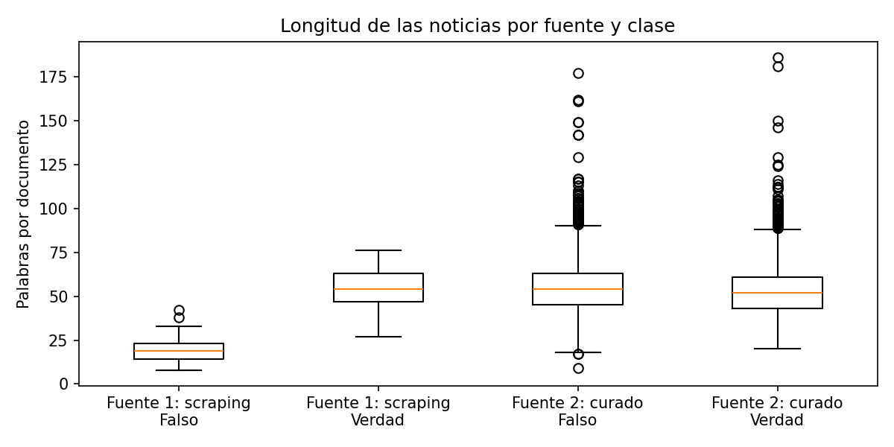
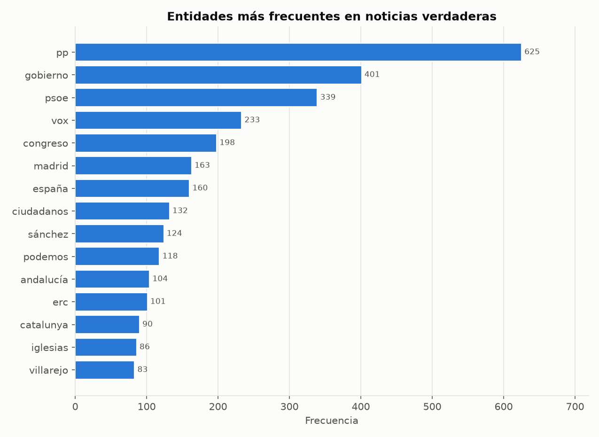
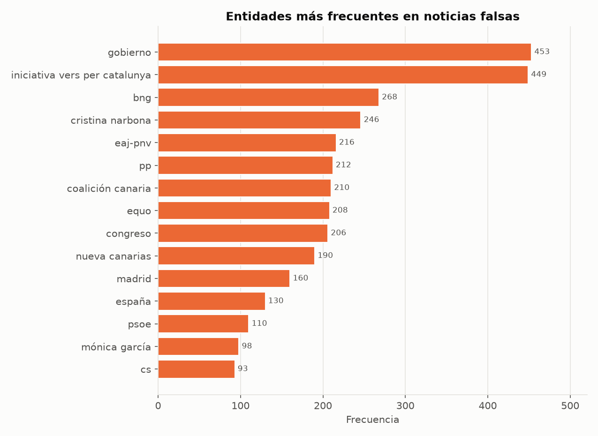
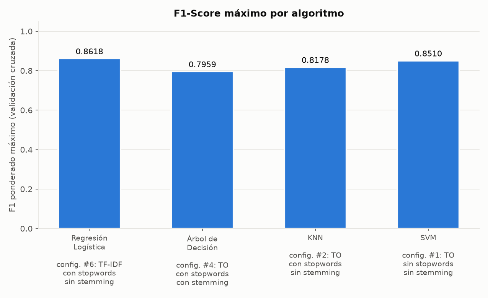
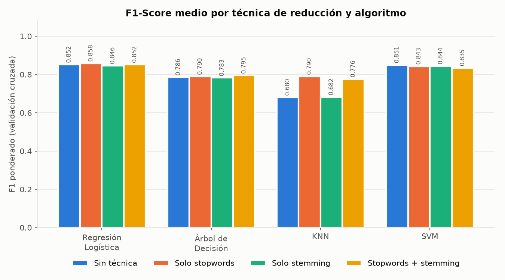
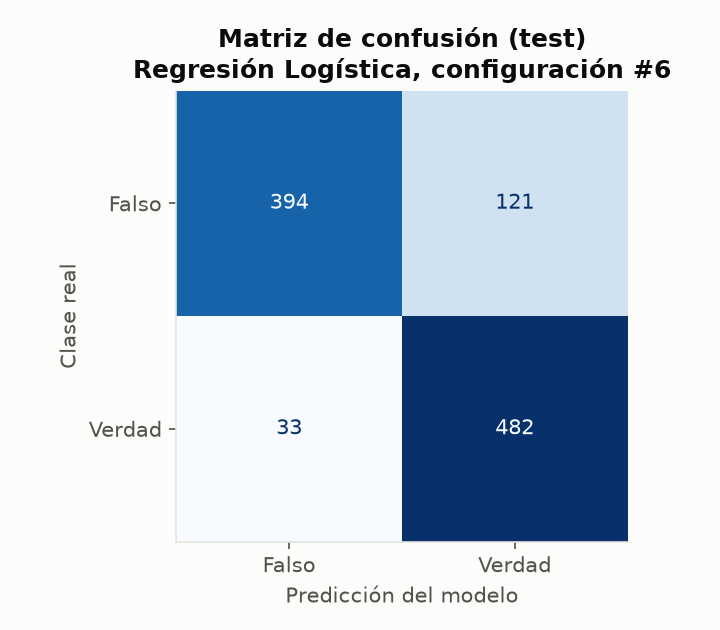

<div align="center">

# Detección de noticias falsas de política en español

**Procesamiento del Lenguaje Natural · corpus de 5.150 noticias · 4 algoritmos x 8 configuraciones**


</div>

Práctica de Procesamiento del Lenguaje Natural (Universidad Nacional de Colombia, Medellín). Se construye un corpus de noticias de política española, se preprocesa, se analiza lingüísticamente (POS y NER) y se entrenan 4 algoritmos de clasificación con 8 configuraciones de representación, evaluados con validación cruzada de 10 particiones.

| 5.150 | 2.575 / 2.575 | 32 | 0,8618 | 0,8494 |
|:---:|:---:|:---:|:---:|:---:|
| noticias | verdaderas / falsas | modelos evaluados | F1 mejor modelo (validación cruzada) | F1 mejor modelo (test) |

Mejor modelo: **Regresión Logística con TF-IDF y stopwords, sin stemming**. Ese valor debe leerse con cautela por la limitación del corpus (ver [Limitaciones](#limitaciones)).

**Contenido:** [Alcance](#alcance) · [Corpus](#corpus) · [Preprocesamiento](#preprocesamiento) · [Características](#características) · [Análisis lingüístico](#análisis-lingüístico) · [Resultados](#resultados-de-clasificación) · [Limitaciones](#limitaciones) · [Reproducir](#cómo-reproducirlo)

## Alcance

| Etapa | Notebook | Estado |
|---|---|---|
| Creación del corpus | `01_corpus.ipynb` | Incluida |
| Preprocesamiento | `02_preprocesamiento.ipynb` | Incluida |
| POS Tagging | `03_pos.ipynb` | Incluida |
| Reconocimiento de entidades (NER) | `04_ner.ipynb` | Incluida |
| Características: BoW (uni y bigramas) y TF-IDF | `05_caracteristicas.ipynb`, `caracteristicas.py` | Incluida |
| Clasificación: 4 algoritmos x 8 configuraciones | `10_clasificacion.ipynb` | Incluida |
| Modelado de temas (LSA y LDA) | — | No incluida en este repositorio |

El análisis escrito de POS y NER está en [`docs/analisis_pos_ner.md`](docs/analisis_pos_ner.md).

## Corpus

5.150 noticias balanceadas: 2.575 verdaderas y 2.575 falsas, un `.txt` por noticia en `corpus/Verdad/` y `corpus/Falso/`. Las tablas con el texto original y el preprocesado están en `datos/corpus.csv` y `datos/corpus_limpio.csv`.

| Fuente | Documentos | Descripción |
|---|---|---|
| Corpus curado | 5.000 (2.500 + 2.500) | *Spanish Political Fake News* (Otero Vizoso, Universidad de Vigo, 2023), disponible en Kaggle, licencia [CC BY 4.0](https://creativecommons.org/licenses/by/4.0/). Política española entre abril de 2017 y junio de 2023. Muestra aleatoria con `random_state=42`. |
| Web scraping | 150 (75 + 75) | Noticias de España publicadas desde 2024. Falsas: afirmaciones de bulos verificados por Maldita (38) y Newtral (37). Verdaderas: título y entradilla de política nacional de elDiario.es (75). |

**Scraping ético.** Se usaron `requests` y BeautifulSoup. Las URLs se obtuvieron de los *sitemaps* oficiales de cada sitio, se verificó con `robots.txt` que las páginas se pueden descargar y se dejó una pausa de 2 segundos entre peticiones. De cada verificación se guardó solo la afirmación falsa, nunca el texto del desmentido. Los textos son fragmentos cortos (de 8 a 76 palabras) con su URL de origen; pertenecen a sus respectivos medios.

Longitud media: 53,94 palabras por documento (277.794 en total). Las dos clases son casi idénticas (≈ 54 palabras). Dentro del scraping, los bulos son más cortos (≈ 20 palabras) que las noticias verdaderas (≈ 55).

<p align="center"></p>

## Preprocesamiento

Se aplica sobre el texto original y se guarda aparte: minúsculas, eliminación de tildes (se conserva la ñ), números, enlaces, saltos de línea, HTML, puntuación y emojis. El vocabulario baja de 30.196 a 18.690 palabras distintas (−38 %). POS y NER usan el texto original, porque necesitan mayúsculas y puntuación; la clasificación usa el texto preprocesado.

## Características

- **Bolsa de palabras** con unigramas y bigramas, ponderada por conteo de ocurrencias (TO) o por **TF-IDF**.
- **Stopwords:** lista de NLTK en español, sin tildes para coincidir con el texto limpio. Con stopwords se descartan los términos con frecuencia menor a 3.
- **Stemming:** Snowball en español.
- Las 2 ponderaciones x stopwords sí/no x stemming sí/no dan **8 configuraciones**, definidas en `caracteristicas.py`.

## Análisis lingüístico

Con spaCy (`es_core_news_sm`), procesando cada clase por separado:

- **POS:** las categorías NOUN, VERB, ADJ, ADV y PRON difieren en menos de un punto porcentual entre clases. Los nombres propios sí se separan: 15,25 % en falsas y 13,01 % en verdaderas.
- **NER:** hay 13.949 entidades en verdaderas y 14.655 en falsas. En las verdaderas dominan PP, PSOE, Vox y Podemos; en las falsas, partidos regionales o minoritarios como BNG, EAJ-PNV, Coalición Canaria, Equo y Nueva Canarias. El modelo pequeño comete errores de tipo y de detección, documentados con cinco casos en `04_ner.ipynb`.

<p align="center"> </p>

El análisis completo, con tablas y errores del NER, está en [`docs/analisis_pos_ner.md`](docs/analisis_pos_ner.md).

## Resultados de clasificación

Regresión Logística, Árbol de Decisión, KNN (coseno, k=5) y SVM lineal. División estratificada 80 / 20 (4.120 / 1.030). Validación cruzada de 10 particiones sobre el 80 %, y confirmación en el 20 %. Métrica de referencia: F1 ponderado.

**F1 ponderado en validación cruzada** (configuraciones del 1 al 8):

| # | Ponderación | Stopwords | Stemming | Reg. Logística | Árbol | KNN | SVM |
|---|---|---|---|---:|---:|---:|---:|
| 1 | TO | No | No | 0,8566 | 0,7866 | 0,6380 | **0,8510** |
| 2 | TO | Sí | No | 0,8551 | 0,7902 | **0,8178** | 0,8368 |
| 3 | TO | No | Sí | 0,8499 | 0,7829 | 0,6451 | 0,8423 |
| 4 | TO | Sí | Sí | 0,8481 | **0,7959** | 0,7951 | 0,8237 |
| 5 | TF-IDF | No | No | 0,8481 | 0,7855 | 0,7226 | 0,8502 |
| 6 | TF-IDF | Sí | No | **0,8618** | 0,7889 | 0,7615 | 0,8491 |
| 7 | TF-IDF | No | Sí | 0,8419 | 0,7822 | 0,7197 | 0,8466 |
| 8 | TF-IDF | Sí | Sí | 0,8553 | 0,7945 | 0,7578 | 0,8459 |

**Mejor configuración por algoritmo:**

| Algoritmo | Config. | F1 (validación cruzada) | F1 (test) |
|---|---|---:|---:|
| Regresión Logística | #6 (TF-IDF, stopwords) | 0,8618 | 0,8494 |
| SVM | #1 (TO) | 0,8510 | 0,8502 |
| KNN | #2 (TO, stopwords) | 0,8178 | 0,7864 |
| Árbol de Decisión | #4 (TO, stopwords, stemming) | 0,7959 | 0,7905 |

**Mejor modelo en test** (Regresión Logística, config. #6, 1.030 documentos):

| Clase | Precision | Recall | F1 |
|---|---:|---:|---:|
| Falso | 0,9227 | 0,7650 | 0,8365 |
| Verdad | 0,7993 | 0,9359 | 0,8623 |
| Exactitud global | | | 0,8505 |

Lecturas del experimento:
- Los modelos lineales superan a KNN y al Árbol.
- La ponderación casi no cambia el resultado.
- Quitar stopwords sube el F1 de KNN de 0,680 a 0,790 en promedio. El stemming no mejora a ningún algoritmo.
- El F1 en test es parecido al de validación cruzada (diferencia media de −0,0064), sin señales de sobreajuste.

Los términos que más empujan hacia "falsa" son partidos y personas poco frecuentes en estas noticias: Equo, BNG, Cristina Narbona, EAJ-PNV, Coalición Canaria, Nueva Canarias.

<p align="center"> </p>

<p align="center"></p>

## Limitaciones

**Las noticias falsas del corpus de Vigo son fabricadas**: noticias reales alteradas o generadas con IA, no desinformación circulada. El clasificador aprende a detectar esa fabricación, sobre todo actores políticos fuera de lugar, y no la falsedad en general. Por eso un F1 alto debe leerse con cautela.

La evidencia está en el acierto por fuente (validación cruzada sobre todo el corpus, con el mejor modelo):

| Fuente | Clase | Documentos | Acierto |
|---|---|---:|---:|
| Corpus curado (Vigo) | Verdad | 2.500 | 94,80 % |
| Corpus curado (Vigo) | Falso | 2.500 | 80,12 % |
| elDiario.es | Verdad | 75 | 97,33 % |
| Maldita | Falso | 38 | 34,21 % |
| Newtral | Falso | 37 | 43,24 % |

El modelo acierta el 80 % de las falsas fabricadas, pero solo el 39 % de los bulos reales de Maldita y Newtral (29 de 75). Para un detector útil habría que entrenar con bulos verificados. Además, los 150 documentos del scraping son una muestra pequeña.

## Cómo reproducirlo

1. Python 3 y las dependencias:
   ```bash
   pip install pandas scikit-learn nltk spacy matplotlib jupyter requests beautifulsoup4
   python -m spacy download es_core_news_sm
   ```
2. Ejecutar los notebooks desde la raíz del repositorio, en orden: `02`, `03`, `04`, `05` y `10`. Usan `datos/corpus.csv` y `datos/corpus_limpio.csv`, ya incluidos, y semilla `42`. Las tablas y gráficos se guardan en `resultados/`, que ya incluye los generados por la última ejecución.
3. **No es necesario ejecutar `01_corpus.ipynb`.** Vuelve a hacer el scraping y el corpus cambiaría, porque los sitios publican bulos nuevos cada día. Su documentación y las salidas guardadas describen cómo se construyó.

## Estructura

```
corpus/Verdad, corpus/Falso    noticias en .txt
resultados/                   tablas y gráficos de cada notebook
datos/                         corpus.csv, corpus_limpio.csv, estadísticas y datos del scraping
docs/analisis_pos_ner.md       análisis escrito de POS y NER
docs/equipo/                   notas internas de coordinación del equipo
caracteristicas.py             BoW, TF-IDF, stopwords y stemming
0X_*.ipynb, 10_*.ipynb         notebooks de cada etapa
```

## Equipo

Equipo 1 del curso de Procesamiento del Lenguaje Natural. Daniel Garzón ([@Dgarzonac9](https://github.com/Dgarzonac9)) y compañeros de equipo.

## Licencias y atribución

- Corpus curado: *Spanish Political Fake News*, Otero Vizoso (Universidad de Vigo, 2023), [CC BY 4.0](https://creativecommons.org/licenses/by/4.0/). El archivo original está en `datos/D57000_complete.csv`.
- Los fragmentos obtenidos por scraping pertenecen a Maldita.es, Newtral y elDiario.es, y se incluyen con su enlace de origen con fines académicos.
